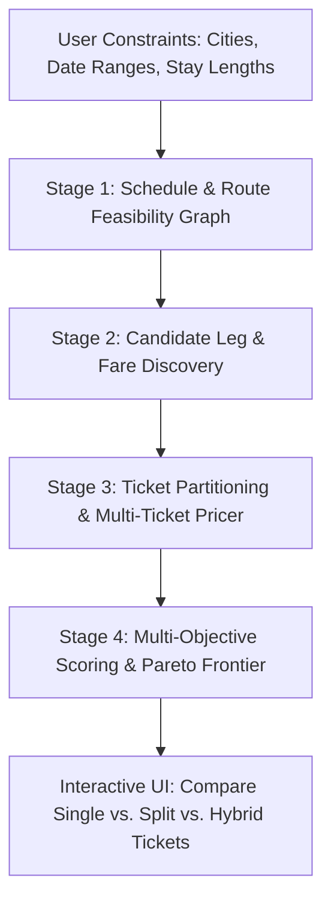

# Multi-City Flight & Ticket Optimization App — Design Document

## 1. Problem Overview
Planning a trip across multiple cities with flexible date ranges involves two intertwined optimization problems:
1. **Route & Schedule Optimization (The "Traveling Salesperson with Time Windows" Problem):** Determining the order of cities (if flexible) and exact travel dates within allowed stay durations/date windows.
2. **Ticket Structure Optimization (The "Fare Partitioning" Problem):** Determining *how to book* those flights. Airline pricing is non-linear:
   - Legacy carriers often price **One-Way (OW)** international legs expensively compared to **Round-Trip (RT)**, **Open-Jaw (OJ)**, or **Multi-City (MC)** itineraries on a single ticket (PNR).
   - Low-Cost Carriers (LCCs) price point-to-point (one-way) competitively.
   - **Nested Tickets** or **Split Ticketing** (e.g., an overarching round-trip hub ticket combined with regional one-way or round-trip tickets) can drastically cut costs.
   - **Self-Transfers vs. Protected Transfers:** Combining separate tickets introduces misconnection risk, baggage re-check fees, and minimum buffer time requirements.

The goal of this application is to take a user's desired cities and date/duration constraints and compute the **Pareto-optimal itineraries** balancing **Total Cost**, **Total Travel Time**, **Number of Transfers**, and **Booking Complexity / Self-Transfer Risk**.

---

## 2. Core Concepts & Data Model

### 2.1 User Input Specification
- **Origin & Final Destination:** Starting city/airports (e.g., `SFO`) and ending city/airports (often the same as origin, or open-ended).
- **Trip Window:** Earliest departure date and latest return date.
- **City Stops (`StopSpec`):**
  - `locations`: One or more explicit airport codes (e.g., `LHR, LGW`) with UI suggestions for nearby/metro airports (e.g., typing "London" suggests `LHR`, `LGW`, `STN`, `LTN`, `LCY` as selectable chips so the user can toggle exactly which airports are acceptable).
  - `dateWindow`: Allowed arrival/departure date range (e.g., "between Nov 10 and Nov 25").
  - `stayDuration`: Min and max nights in the city (e.g., `3 to 5 nights`).
  - `orderConstraint`: Fixed sequence, partial precedence (e.g., "Tokyo before Kyoto"), or unordered (optimizer chooses best sequence).
- **Preferences & Constraints:**
  - **Baggage Toggle:** Trip-wide toggle/selector for baggage (e.g., `[x] Include Checked Bag` / `[x] Include Carry-on Bag`). When enabled:
    - Adds estimated bag fees per separate ticket/LCC leg where not included in base fare.
    - Increases minimum safe self-transfer buffer at intermediate hubs (to account for baggage claim, customs, and bag drop).
  - **No Hidden-City / Throwaway Ticketing:** Strictly uses legitimate, fully-flown ticket structures (One-Way, Round-Trip, Open-Jaw, Multi-City, and Nested Round-Trip).
  - **Cross-Airport Ground Transfers:** Allowed during a city stay (e.g., arrive `NRT`, stay 4 days in Tokyo, depart `HND`), and penalized/configurable if occurring during a tight transit connection.
  - **Per-Flight & Duration-Based Cabin Class Selector:**
    - **Global Default & Duration Rule:** Set a default cabin class (`Economy`, `Premium Economy`, `Business`, `First`) plus an optional duration threshold rule (e.g., *"Require `Business` for flights $\ge 6$ hours, allow `Economy` on shorter flights"*).
    - **Per-Leg / Per-Stop Override:** Each stop/leg in the UI includes its own cabin selector (`Auto (by duration)`, `Economy`, `Premium Economy`, `Business`, `First`) so you can explicitly require Business on a specific overnight/long-haul leg while accepting Economy on short regional hops.
    - **Mixed-Cabin Ticket Partitioning Synergy:** When long-haul legs require `Business` and regional legs allow `Economy`, a single all-in-one Multi-City ticket often prices the *entire* itinerary in Business (or fails to combine). Splitting into a **Business Class Open-Jaw/Round-Trip anchor ticket** + **Economy Class regional One-Way tickets** is automatically evaluated by the partitioner to unlock massive savings.
  - **Client-Side State Persistence (Cookies / LocalStorage):**
    - All user inputs (cities, selected airport chips, date ranges, stay durations, per-leg cabin classes, baggage checkboxes, and optimization weights) are automatically saved to client-side cookies / storage and restored on page load.
  - Max stops per leg & max layover duration.
  - Trade-off weights or hard caps:
    - Value of time (e.g., `$X per hour of extra travel time`).
    - Penalty per transfer (protected vs. unprotected self-transfer).

### 2.2 Flight & Ticket Primitives
- **Segment:** A single takeoff and landing (e.g., `SFO -> NRT` on UA 837).
- **Leg (Slice):** A journey between two user-specified stops (may include 0, 1, or 2+ connecting segments).
- **Ticket (PNR):** A bookable unit containing 1 or more legs priced together:
  - **One-Way (OW):** Single leg `A -> B`.
  - **Round-Trip (RT):** `A -> B` and `B -> A`.
  - **Open-Jaw (OJ):** `A -> B` and `C -> A` (or `A -> B` and `B -> C`).
  - **Multi-City (MC):** `A -> B`, `B -> C`, `C -> A` on a single ticket/alliance.
- **Itinerary Plan:** A complete sequence of legs covering all required stops, partitioned into a set of **Tickets** whose union covers every leg in the trip.

---

## 3. Optimization Engine Architecture

The optimization pipeline runs in four stages:

### Stage 1: Schedule & Route Enumeration
- Builds a **Time-Expanded Directed Acyclic Graph (DAG)** of valid `(city, arrival_date, departure_date)` states that satisfy all date ranges and min/max stay durations.
- Prunes infeasible date combinations early.

### Stage 2: Candidate Flight Discovery (Search Strategy)
Querying every multi-city permutation directly is prohibitive due to API rate limits and combinatorial explosion. Instead, we use a **two-tier search**:
1. **Broad One-Way & Round-Trip Matrix Sweep:**
   - Fetch cached/calendar fares or daily one-way & round-trip quotes for each candidate `(City_i, City_j, Date)` pair.
   - Retain the top-$K$ pareto-optimal flights per `(Origin, Dest, Date)` across `(price, duration, stops, alliance)`.
2. **Targeted Multi-City / Open-Jaw Queries:**
   - For the most promising date schedules, query priced **Multi-City** and **Open-Jaw** combinations grouped by airline alliance (`Star Alliance`, `Oneworld`, `SkyTeam`) and major carriers.

### Stage 3: Ticket Partitioning & Intermediate Hub Splitting
Given a sequence of $N$ trip legs $L = \{l_1, l_2, \dots, l_N\}$, we optimize both **how legs are grouped into tickets** and **whether any leg is split at an intermediate transit hub**:

#### 3.1 Leg-Level Hub Splitting (Virtual Interlining)
Before or during ticket partitioning, an expensive or poorly-connected leg $A \to B$ can be expanded into $A \to H \to B$ via a candidate transit hub $H$ (selected from a curated matrix of major global/regional hubs along the geographic corridor):
- **Minimum Self-Transfer Buffer:** Unprotected transfers at $H$ require a configurable safety buffer (e.g., $\ge 4$ hours for same-terminal/schengen, $\ge 5\text{–}6$ hours or overnight for international with customs + baggage re-check).
- **Hub Anchor Nesting:** A hub $H$ can even act as the turnaround point of a cheap long-haul Round-Trip ticket (e.g., `SFO <-> TYO` RT ticket, while using separate regional tickets `TYO -> TPE -> HKG -> TYO`).

#### 3.2 Ticket Partitioning (Set Partitioning Problem)
Given the (potentially hub-expanded) sequence of legs, we partition them into disjoint subsets of bookable tickets $T = \{t_1, t_2, \dots, t_k\}$ where $\bigcup t_i = L$:
- **Strategy A — Single Ticket (All-in-One):**
  - 1 Multi-City ticket covering $(l_1, \dots, l_N)$.
  - Pros: Single booking, protected connections, consistent baggage rules.
  - Cons: If one leg is on a non-partner carrier, the whole ticket may price at full Y/J IATA fares or fail to price.
- **Strategy B — Pure Point-to-Point (All One-Ways):**
  - $N$ separate One-Way tickets.
  - Pros: Mix-and-match any airlines/LCCs.
  - Cons: Long-haul one-way fares on full-service carriers are often 70–120% of a round-trip price.
- **Strategy C — Anchor Ticket + Regional Tickets (Hybrid / Nested / Open-Jaw):**
  - Example: Trip is `SFO -> London -> Paris -> Rome -> SFO`.
  - Anchor Ticket (Open-Jaw): `SFO -> LHR` and `FCO -> SFO` on one transatlantic ticket.
  - Intra-region Tickets: Separate one-way flights (or rail) `LON -> PAR` and `PAR -> ROM`.
- **Strategy D — Split Long-Haul Hub (Self-Transfer & Nested Hub RT):**
  - Example: Replacing an expensive `SFO -> BKK` leg with `SFO -> TPE` (Round-Trip) + `TPE -> BKK` (One-Way or regional Open-Jaw), enforcing that layover buffer at `TPE` $\ge$ minimum safe self-transfer threshold.

### Stage 4: Multi-Objective Scoring & Pareto Frontier
Each complete itinerary is evaluated on a generalized cost function and Pareto dominance:
$$\text{Effective Score} = \text{Total Fare} + \text{Bag Fees} + (\alpha \times \text{Travel Hours}) + (\beta_{\text{prot}} \times N_{\text{prot}}) + (\beta_{\text{self}} \times N_{\text{self}})$$
1. **Total Monetary Cost ($):** Base fares + estimated baggage fees across all separate tickets.
2. **Total Door-to-Door / Air Travel Time (hours):** Flight duration + layover time.
3. **Transfer Count & Risk Score:**
   - Protected airline connection ($\beta_{\text{prot}}$, low penalty).
   - Unprotected self-transfer on separate tickets ($\beta_{\text{self}}$, higher penalty; requires longer connection buffer and baggage re-check).
4. **Pareto Frontier Output:**
   - **Cheapest Overall**
   - **Fastest / Least Transfers**
   - **Best Balanced (Recommended "Sweet Spot")**
   - **Side-by-Side Ticket Strategy Comparison:** Shows the exact price/time delta between *1 Single Multi-City Ticket*, *All Separate One-Ways*, *Open-Jaw + One-Ways*, and *Hub-Split Tickets*.

---

## 4. Flight Data Providers & Granular Caching

We use a unified `FlightSearchProvider` protocol in Python backed by a persistent **two-level SQLite cache** (`flights_cache.db`):
1. **Live Google Flights / SerpApi Adapter (`google_flights.py`):**
   - Queries Google Flights and parses real segments, layover hubs, durations, flight numbers, and fares directly into normalized `FlightLegOption` objects.
2. **Deterministic Airline & Alliance Pricing Engine (`pricing_engine.py`):**
   - Models non-linear Round-Trip/Open-Jaw discounts, intercontinental One-Way surcharges on full-service carriers, point-to-point LCC pricing, and cabin multipliers so the solver works offline out of the box.
3. **Granular SQLite Flight & Quote Cache (`sqlite_cache.py`):**
   - **`leg_search_cache`:** Caches leg search responses keyed by `origin:destination:departure_date:cabin`.
   - **`granular_flights`:** Indexes every individual flight leg discovered by `(origin, destination, departure_date, cabin)`. Its partial results do not replace a missing or expired search response.
   - **`ticket_quote_cache`:** Caches priced multi-slice ticket quotes (`round_trip`, `open_jaw`, `multi_city`).
   - Allows instant re-optimization when tweaking stay lengths, date windows, value-of-time sliders, baggage checkboxes, or per-leg cabin classes.

For the directory layout, setup commands, and pre-commit workflow, see [DEVELOPER.md](DEVELOPER.md). For usage instructions, see [README.md](README.md).
